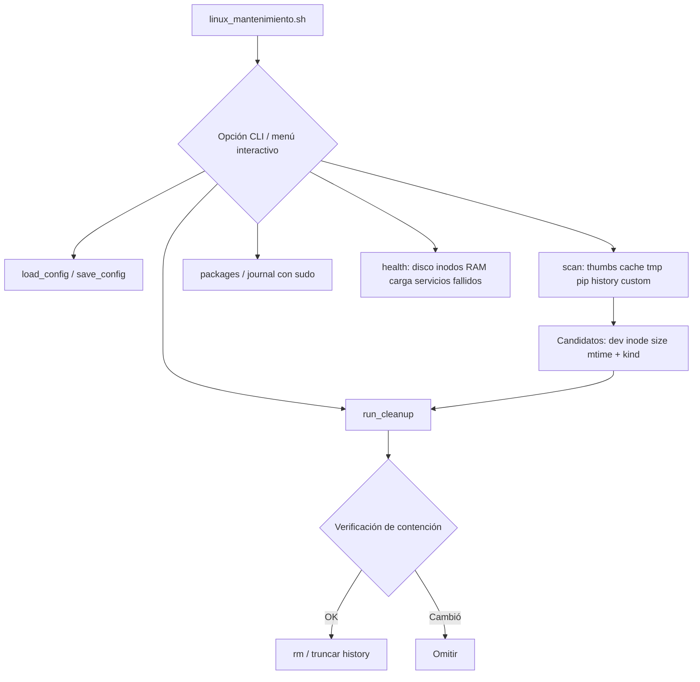

# cleanux

Menú CLI para mantenimiento y limpieza de Debian/Ubuntu y distribuciones basadas en Red Hat (Fedora, RHEL, Rocky, AlmaLinux). Escanea archivos antiguos, muestra el ahorro calculado y elimina solo lo que el usuario habilita.

[](https://www.gnu.org/software/bash/)
[](https://github.com/bi0punk/cleanux/actions/workflows/ci.yml)

## Contenido

- [Características](#características)
- [Arquitectura](#arquitectura)
- [Stack](#stack)
- [Estructura del repositorio](#estructura-del-repositorio)
- [Instalación](#instalación)
- [Uso](#uso)
- [Configuración](#configuración)
- [Límites operativos](#límites-operativos)
- [Tests / CI](#tests--ci)
- [Roadmap](#roadmap)
- [Licencia](#licencia)

## Características

- Siete tareas de limpieza configurables: `thumbs`, `cache`, `tmp`, `pip`, `history`, `packages`, `journal`.
- Escaneo en seco (`--scan`) que informa archivos candidatos y bytes recuperables sin borrar nada.
- Confirmación explícita: `--run` exige escribir `LIMPIAR`; `--run --yes` para automatización.
- Tareas del sistema (paquetes y journal) gestionadas con `sudo` solo cuando se habilitan.
- Rutas personalizadas bajo `$HOME` con validación contra rutas protegidas.
- Verificación de contención justo antes de eliminar (propietario, inode, dispositivo, tamaño y fecha).
- Arquitectura de archivos blanca: configuración guardada como datos (no como comandos) con permisos privados.
- Límite de 50.000 candidatos por ejecución para acotar el uso de RAM.

## Arquitectura



El script nunca ejecuta código almacenado en la configuración: `load_config` lee líneas delimitadas por `|` y las valida antes de aplicar.

## Stack

| Componente | Tecnología |
|---|---|
| Lenguaje | Bash 4.3+ (GNU find, stat, realpath, id) |
| Destinos | Debian/Ubuntu (apt) y Red Hat (dnf) |
| Sistema | systemd (journalctl) |
| Testing | Suite propia en bash + ShellCheck |

## Estructura del repositorio

```
cleanux/
├── linux_mantenimiento.sh   # Script principal (CLI + menú)
├── tests/
│   └── run.sh               # Suite de tests funcionales
├── .github/
│   └── workflows/ci.yml     # CI: bash -n, ShellCheck, tests
├── .vscode/
│   └── settings.json
└── README.md
```

## Instalación

```bash
git clone https://github.com/bi0punk/cleanux.git
cd cleanux
chmod +x linux_mantenimiento.sh
```

No requiere dependencias externas más allá de las herramientas GNU estándar.

## Uso

```bash
./linux_mantenimiento.sh --menu    # Menú interactivo (predeterminado)
./linux_mantenimiento.sh --scan    # Vista previa sin borrar
./linux_mantenimiento.sh --run     # Escaneo + confirmar escribiendo LIMPIAR
./linux_mantenimiento.sh --run --yes  # Confirmación explícita para automatización
./linux_mantenimiento.sh --health  # Diagnóstico: disco, inodos, RAM, carga, servicios fallidos
./linux_mantenimiento.sh --list    # Tareas y configuración
./linux_mantenimiento.sh --help    # Ayuda
```

Tareas:

| ID | Estado inicial | Acción |
| --- | --- | --- |
| `thumbs` | Activa | Miniaturas en `~/.cache/thumbnails` con más de 30 días. |
| `cache` | Activa | Archivos en `~/.cache` con más de 60 días (sin seguir enlaces). |
| `tmp` | Inactiva | Solo archivos regulares del usuario en `/tmp` y `/var/tmp` con más de 14 días. |
| `pip` | Inactiva | Caché de pip con más de 60 días. |
| `history` | Inactiva | Vacía el contenido de `~/.bash_history` y `~/.zsh_history`. |
| `packages` | Inactiva | `apt-get autoclean` o `dnf clean packages` según la distribución. |
| `journal` | Inactiva | `journalctl --vacuum-time=30d` (solo diarios archivados). |

## Configuración

```bash
./linux_mantenimiento.sh --enable tmp
./linux_mantenimiento.sh --set-days tmp 21
./linux_mantenimiento.sh --enable packages
./linux_mantenimiento.sh --add-path "$HOME/.local/state/mi-app/cache" 30
./linux_mantenimiento.sh --remove-path 0
```

La carpeta personalizada debe existir dentro de `HOME`, no ser un enlace simbólico y no estar bajo ubicaciones protegidas como `Documents`, `Downloads`, `Desktop`, `Pictures`, `.ssh`, `.gnupg` o `.config`. Se eliminan solo archivos regulares antiguos, no la carpeta ni sus subcarpetas vacías. La configuración se guarda en `${XDG_CONFIG_HOME:-$HOME/.config}/linux-mantenimiento/config` con permisos privados (`umask 077`).

## Límites operativos

- El escaneo usa fechas de modificación (`mtime`) y tamaño lógico; los bytes recuperados pueden diferir por compresión, enlaces duros y sistema de archivos.
- No sigue enlaces simbólicos ni atraviesa montajes. Antes de actuar comprueba propietario, inode, dispositivo, tamaño y fecha, y omite los que cambiaron.
- Los archivos abiertos por procesos pueden seguir ocupando espacio hasta que el proceso termine; los shells abiertos pueden reescribir su historial al cerrar.
- Máximo 50.000 candidatos por ejecución; si se alcanza, el escaneo lo avisa.
- No ejecuta `autoremove`, no vacía la papelera, no borra logs activos y no actualiza ni instala paquetes.

## Tests / CI

```bash
bash -n linux_mantenimiento.sh
./tests/run.sh
shellcheck linux_mantenimiento.sh tests/run.sh   # lint completo
```

La CI de GitHub Actions ejecuta sintaxis, ShellCheck y la suite local en Ubuntu (`tests/run.sh`): ayuda y lista, persistencia de configuración, validación de rutas personalizadas, borrado solo de candidatos antiguos y truncado de historial.

## Roadmap

- [x] Tareas de limpieza configurables y rutas personalizadas
- [x] Suite de tests funcionales y CI
- [ ] Ampliar la información del escaneo (p. ej. filtrado por tipo de archivo)
- [ ] Más opciones de automatización y reporte para uso en scripts

## Licencia

Sin archivo LICENSE declarado en el repositorio.